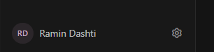

# Sidebar user profile row

## When to use

- Authenticated app with a **sidebar** and signed-in user
- User asks for profile in sidebar, avatar + name footer, or settings gear beside profile
- Replacing a plain “Profile” nav item with a compact identity row
- Exclusions: no signed-in user (hide row); do not add a **second** full-width Settings nav item if the gear already opens Settings

## Objective

1. Anchor the row at the **bottom** of the sidebar (below status/admin blocks), last item in the footer stack
2. Match the reference layout: **avatar | name | settings gear**
3. Share display-name / initials logic with the profile modal or About Me views
4. Support **collapsed** sidebar without losing profile or settings entry points

## Visual reference



| Element | Spec |
|--------|------|
| Avatar | Circle, ~36px (`size-9`); background one step lighter than sidebar (`var(--hx-bg-d)` or project panel token) |
| Initials | 2 letters, semibold, small type; accent violet on dark (`text-violet-300/90`), darker violet on light (`[data-theme=light]:text-violet-700`) |
| Name | `text-sm font-medium`, bright foreground (`text-ink`), **truncate** with `min-w-0` |
| Settings | Outlined gear icon, muted default, brighter on hover; ~16px icon, `strokeWidth` ~1.75 |
| Row | Horizontal flex, vertically centered; subtle hover on avatar+name block only |

Use project design tokens (`--hx-*`, `text-ink`, `text-muted`, `bg-fog`) instead of one-off hex when the host app already defines them.

## Navigation & interaction

| Target | Route / action |
|--------|----------------|
| Avatar + name | Profile route (Helix: `/profile`) |
| Gear icon | Settings route (Helix: `/settings`) |

- Gear: `aria-label` + `title` from i18n (`nav.settings`)
- Avatar+name link: `title` = profile label or full display name
- Collapsed sidebar: stack **avatar** (profile) then **gear** (settings), centered, same routes

Do **not** duplicate a separate “Settings” list item above this row when the gear is present.

## Data & helpers

User object should expose at least `username` and `display_name` (full name string).

Shared helpers (copy or import pattern from Helix `helix-webui/src/utils/userDisplay.js`):

| Function | Purpose |
|----------|---------|
| `splitDisplayName(displayName, username)` | First / last name from `display_name`, fallback to username |
| `profileInitials(firstName, lastName, username)` | Two-letter avatar label |
| `formatUserDisplayName(user)` | Single line for sidebar truncation |

Initials rules:

1. First + last name present → first char of each, uppercased
2. Else two words in one string → first char of first two words
3. Else first two chars of username (or `?`)

Display name rules:

1. `firstName + lastName` from split
2. Else `display_name`, else `username`

## Placement in layout

```
sidebar
  … nav groups …
  mt-auto footer
    admin (optional)
    status / health (optional)
    SidebarUserProfile   ← last
```

## Reference implementation

| App | Files |
|-----|--------|
| **Helix** | `helix-webui/src/components/Layout.jsx` (`SidebarUserProfile`), `helix-webui/src/utils/userDisplay.js` |

Component checklist:

- [ ] Row at bottom of sidebar footer
- [ ] Circular initials avatar + truncated display name + settings gear
- [ ] No duplicate Settings nav item when gear exists
- [ ] Collapsed mode: avatar + gear stack
- [ ] Shared initials/name helpers with profile UI
- [ ] i18n labels for profile and settings
- [ ] Light and dark theme readable

## Safety rules

1. **Always** truncate long names; never overflow the sidebar width.
2. **Always** provide a settings entry (gear) when removing a standalone Settings nav link.
3. **Never** show the row when `user` is null.
4. **Never** fork initials logic in sidebar and profile modal—one util module.
